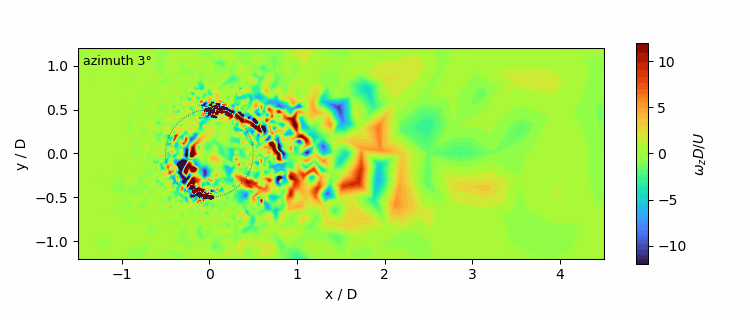
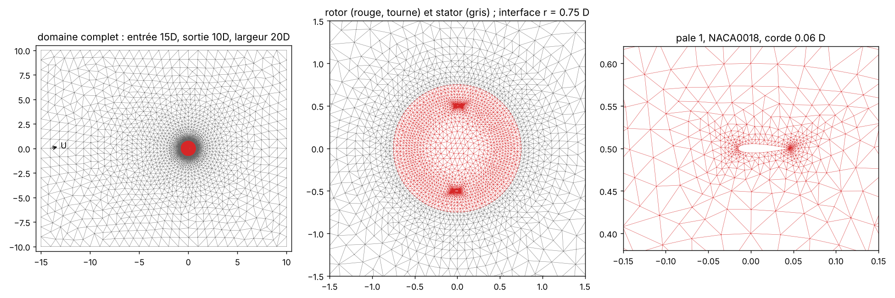
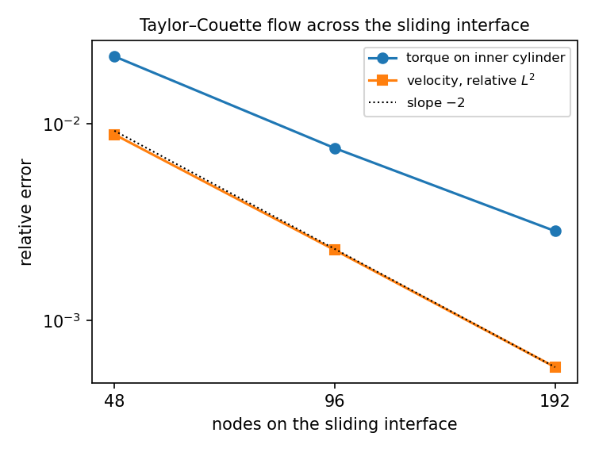
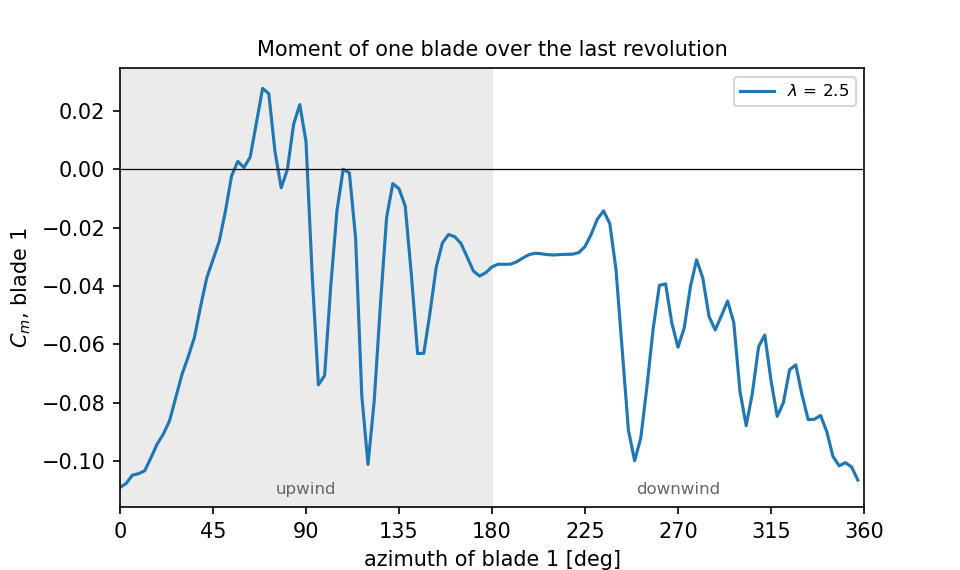

# darrieus

[](https://github.com/abderrazzak-elammari/darrieus/actions/workflows/ci.yml)


Two-dimensional H-Darrieus (vertical axis) wind turbine with a rotating rotor, solved
with FreeFEM. Incompressible Navier–Stokes, Taylor–Hood elements, BDF2 in time, and a
sliding mesh: the rotor disc turns by exactly one interface spacing per time step and is
glued back onto the fixed stator, so the mesh is conforming at every step and no
interpolation is needed across the interface. Cases are run and post-processed from
Python.



*Vorticity over the last revolution, λ = 2.5, Re_D = 5000. The blades shed the vortices
of their own wake and cross it again on the downwind half.*

## Geometry and conditions



The layout follows the guidelines of Rezaeiha, Montazeri & Blocken (2018), who studied
how far the boundaries have to be for the results not to depend on them:

| | this work | Rezaeiha et al. |
|---|---|---|
| blades | 2 × NACA0018, chord c = 0.06 D, pivot at quarter chord | same |
| solidity N c / D | 0.12 | 0.12 |
| rotor core (sliding interface) | 1.5 D | 1.5 D |
| inlet, outlet | 15 D upstream, 10 D downstream | ≥ 15 D, ≥ 10 D |
| domain width | 20 D | 20 D |
| azimuthal step | 3° (N = 120 steps per revolution) | 0.1–0.5° |
| Reynolds number U D / ν | 5 000, laminar | ≈ 10⁶, URANS |

Uniform velocity at the inlet, slip on the side walls, zero traction at the outlet, no
slip on the blades, which move with the rotor. Lengths are scaled by the rotor diameter
D and velocities by the free stream U, so the only parameters are the tip speed ratio
λ = ωR/U and the Reynolds number.

The Reynolds number is the main difference with the reference. The runs here are laminar
and two orders of magnitude below a real turbine, so that the Navier–Stokes equations
can be solved as they are, without a turbulence model, on a mesh that a direct solver
handles on a laptop. The results are those of a small rotor in a viscous flow, not of a
wind turbine; see the discussion below.

## Verification

Three checks, from the solver to the rotor.

**Navier–Stokes discretisation.** Steady flow past a cylinder in a channel, benchmark
2D-1 of Schäfer & Turek (1996), Re = 20, same elements and same force evaluation (boundary
traction) as for the rotor. Reference values from John (2004).

| mesh | cells | dofs | c_D | c_L | Δp |
|---:|---:|---:|---:|---:|---:|
| 16 | 3 270 | 15 275 | 5.5579 | 0.0252 | 0.11770 |
| 32 | 12 522 | 57 469 | 5.5697 | 0.0096 | 0.11755 |
| 64 | 51 334 | 233 243 | 5.5764 | 0.0102 | 0.11752 |
| reference | | | 5.5795 | 0.0106 | 0.11752 |

**Sliding interface.** Taylor–Couette flow: inner cylinder spinning at ω, outer one
fixed, interface halfway between them, so the whole flow crosses it. The exact solution
is u_θ = A r + B / r and the torque on the inner cylinder is −4πνB.

| nodes on the interface | torque | error | velocity error, L² |
|---:|---:|---:|---:|
| 48 | −0.4096 | 2.2 % | 0.88 % |
| 96 | −0.4157 | 0.75 % | 0.23 % |
| 192 | −0.4177 | 0.28 % | 0.058 % |
| exact | −0.4189 | | |



The velocity converges at second order through the rotating interface; the torque, a
boundary derivative, at first order with a constant small enough for the coarse mesh to
be within 2 %. These two cases run in the CI on every push.

**Periodicity.** The rotor is run for five revolutions; the mean torque of the last two
differs by 0.25 % of the torque amplitude (Rezaeiha et al. ask for 0.2 % of the mean
C_m, which here is of the same order as the amplitude).

## Results



At λ = 2.5 and Re_D = 5000 the rotor **absorbs** power: C_P = −0.26, and the moment of
a blade is negative over the whole revolution. The blade chord Reynolds number is
U_rel c / ν ≈ 1 000, a regime where a NACA0018 has a lift-to-drag ratio of a few units
at best; a Darrieus blade needs about λ of it to drive the rotor against its own drag.
What the figure shows is a thick laminar profile dragged through a viscous fluid: the
moment is least negative upwind, around 90°, where the angle of attack is highest, and
most negative near 0° and 360°, where the blade meets its own wake. The oscillations
upwind are the vortices shed by the blade at this Reynolds number.

This is the expected physics at this scale, and it is reported as such rather than
tuned away. Runs at Re_D = 10 000 and 20 000 diverge on the present mesh: the blade
boundary layer is no longer resolved and the Galerkin discretisation has no
stabilisation. Getting a positive C_P needs either a higher solidity at the same
Reynolds number or a finer rotor mesh with a stabilised (SUPG) convection term; both
are a change of a few lines in `darrieus.edp` and `sliding.idp`, but the cost per run
grows with the mesh, which the direct solver limits to about 30 000 triangles.

## How it works

```
darrieus.edp ──► rotor0, stator ──► sliding.idp ──► ADVANCE ×N per revolution ──► CSV
                (buildmesh)        (P2/P1, BDF2)   (rotate, glue, transfer, solve)
```

- **Sliding mesh.** The rotor is meshed once, inside the interface circle with N nodes
  on it, the stator once outside with the same N nodes. Each step turns the rotor by
  2π/N with `movemesh` and glues it onto the stator (`Th = stator + rotor`): FreeFEM
  merges the coincident interface vertices and the result is a single conforming mesh.
  The time step is tied to the mesh, Δt = 2π/(N|ω|).
- **Field transfer.** The two previous solutions are carried to the new mesh by
  evaluating them at the pre-image of each node, x ↦ R(−Δθ) x in the rotor and x in the
  stator. In the rotor the nodes follow the rotation, so this is exact except at the
  interface nodes, which are shared.
- **ALE formulation.** In the rotor the convective velocity is u − w with w = ω × r the
  mesh velocity; in the stator w = 0. The convective velocity is extrapolated from the
  two previous steps, so each step is one linear system in (u, p), assembled on the glued
  mesh and solved with UMFPACK.
- **Forces.** From the boundary traction σ·n with σ = −pI + ν(∇u + ∇uᵀ), the same
  expression that gives the cylinder drag above to 0.06 %.

## Running it

Requires FreeFEM 4.x (`FreeFem++` on the path, or `FREEFEM` set to the binary) and
Python ≥ 3.10.

```bash
pip install -e ".[dev]"
pytest                                        # Python side only, no FreeFEM

python scripts/run.py couette --N 48 96 192   # ~10 min
python scripts/run.py cylinder --n 16 32 64   # ~3 min
python scripts/run.py rotor --tsr 2.5 --revs 5 --snap 4     # ~25 min, with vorticity frames
python scripts/run.py rotor --tsr 1.5 2 3 --revs 5 --jobs 2
python scripts/figures.py                     # figures and results/summary.json
```

Each script also runs on its own, from the command line or from FreeFem++-cs, with the
parameters set at its top; `run.py` changes them by writing `freefem/override.idp` into a
copy of the scripts:

```bash
cd freefem && FreeFem++ -nw darrieus.edp
```

The figures can be regenerated from the stored CSV files without FreeFEM.

## Layout

```
freefem/
    common.idp        differential macros, traction
    override.idp      empty; run.py writes parameter overrides here
    sliding.idp       sliding-mesh solver, one ADVANCE macro per time step
    couette.edp       Taylor-Couette verification
    cylinder.edp      Schafer-Turek benchmark 2D-1 (Newton, steady)
    darrieus.edp      the rotor
src/darrieus/
    reference.py      exact Couette solution, benchmark values
    rotor.py          torque histories, Cm, Cp, periodicity
    freefem.py        runs the scripts
scripts/              run.py (cases), figures.py, check_ci.py
results/              CSV of the runs shown above
tests/                unit tests, no FreeFEM needed
```

## Design notes

- Rotating by exactly one interface spacing per step avoids a non-conforming interface
  and the mortar or interpolation it needs. The price is that Δt and the azimuthal
  resolution are the same number; N = 120 is coarse by the standards of the URANS
  literature (0.1–0.5°) and is what the cost of the direct solve allows here.
- A first version used a pressure-correction (projection) scheme to replace the saddle
  point system by three smaller ones. On the moving mesh it was not stable, even with a
  skew-symmetric convection term, and it was dropped for the coupled solve.
- Two FreeFEM traps are documented in the scripts: a function that reassigns the mesh
  crashes the interpreter, hence the `ADVANCE` macro, and a finite element function
  only follows a new mesh when assigned an expression, not through `u[] = `.

## References

- Rezaeiha, A., Montazeri, H. & Blocken, B. (2018). *Towards accurate CFD simulations
  of vertical axis wind turbines at different tip speed ratios and solidities: guidelines
  for azimuthal increment, domain size and convergence.* Energy Conversion and Management
  156, 301–316.
- Schäfer, M. & Turek, S. (1996). *Benchmark computations of laminar flow around a
  cylinder.* Notes on Numerical Fluid Mechanics 52, 547–566.
- John, V. (2004). *Reference values for drag and lift of a two-dimensional
  time-dependent flow around a cylinder.* Int. J. Numer. Meth. Fluids 44, 777–788.
- Hecht, F. (2012). *New development in FreeFem++.* J. Numer. Math. 20, 251–265.

## License

MIT
